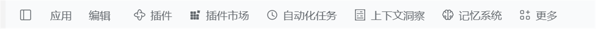
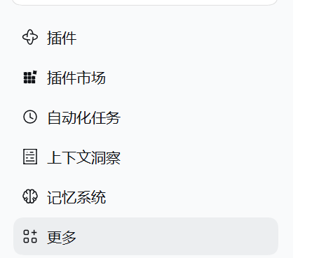

# dsh-panel-titlebar

[](https://github.com/githublmk/dsh-panel-titlebar/actions/workflows/ci.yml)
[](https://www.npmjs.com/package/dsh-panel-titlebar)
[](LICENSE)
[](https://github.com/deepseek-ai/deepseek-harness)

English | [简体中文](README.zh.md)

Puts the sidebar's global panel entries where a Windows app usually keeps its navigation: in the caption row, right after the **应用 / 编辑** menus.



## The problem

A DeepSeek Harness profile that installs a few panels (Plugins, Market, Schedules, Context insight, Memory, More) renders every one of them as a full-width row at the top of the sidebar. On a laptop that is roughly **240px of vertical space** taken from the session list, on every screen, permanently:



## What it changes

The rows keep their icons, labels, active state and click behaviour, and move into the caption band as compact menu items sized like the menus they follow. The sidebar starts directly with the brand row, the New session button and the workspace list:


The session stats that ship below the composer — turn and step counts, decode speed, token total, cache hit and the context meter — move up into the View tab row, right after its **…** launcher.

## How it works

- The navigation stays the sidebar plugin's own registration in `sidebar.panellist`. Nothing is copied, wrapped, replaced or removed, so the **More** launcher, its pin/unpin menu, the active-panel highlight and the analytics of the shipped entries are untouched.
- One stylesheet takes that existing `nav` out of the sidebar flow (`position: fixed`) and lays its rows out horizontally in the caption band. Row metrics follow the caption menus: 28px high, 14px text, 6px radius, secondary label colour, hover and active from the theme tokens.
- The stylesheet is scoped to `html[data-windows-titlebar]`, a marker only the Desktop preload sets. The plain Web GUI keeps the shipped vertical list.
- Harness `0.2.2` wraps each panel entry in a `panelEntry` (the More launcher keeps its own `moreAnchor` wrapper) and moves the nav into the sidebar's scroll ports, so the marker is matched at any depth, the wrapper is the caption flex item, and the compact metrics sit on the row. The inline unpin button is hidden there — a menu bar has no room for a hover slot, and unpinning from it would delete the entry under the pointer — while pin/unpin stays in the **More** menu.
- `0.2.2` also makes the scroll port and its region query containers (`container-type: size` / `scroll-state`), and a query container is a containing block for fixed descendants. The stylesheet withdraws that containment while the marker is set, for the same reason it withdraws the composer seat's `will-change` for the stats below. The workspace list's trailing-scrollbar query is the only consumer the withdrawal drops.
- The left offset is **measured**, not hardcoded: the plugin reads the right edge of the preload-injected `[data-windows-menu]` host into `--dsh-panel-titlebar-left` and keeps it current, so collapsing the sidebar (menu start moves 48px → 84px), switching locale, or resizing stays aligned.
- The entries work as a **toggle**: clicking the selected entry again returns to the conversation (`layout.selectPanel(null)`, the same destination as a panel's own “back to chat”), instead of re-selecting the panel that is already open. The click is stopped before the shipped handler runs; the **More** launcher never acts as a panel entry, so it keeps opening its menu. The selected row is recognised from the shipped `aria-current="page"` marker, so the toggle works with and without the `0.2.2` wrapper.
- The stats keep their own registration in `conversation.composer.dock` and their own dialogs; only their seat moves. The dock still renders the pills, but is positioned from the View tab row's **…** launcher (`--dsh-statbar-top` / `--dsh-statbar-left`), vertically centred in that row. While the anchor is missing — no session, a panel page, a collapsed layout — the plugin removes `data-dsh-statbar` and the dock falls back to its shipped place below the composer.

The hoist is `position: fixed`, so it needs the dock's fixed box to resolve against the viewport. Harness `0.2.2` keeps the sticky composer on its own compositor layer with `will-change: transform` on the seat, which also makes that seat the containing block for fixed descendants; the plugin withdraws that hint while the marker is set, and checks on every pass that the dock actually landed on the measured seat. A build that captures the fixed box some other way drops the marker after three passes and keeps the shipped place.

## Requirements

- DeepSeek Harness **Desktop** on Windows — the caption row exists only there. The plain Web build has no caption band, so the plugin is inert by design.
- Harness `>= 0.2.1-0` (the sidebar that renders `sidebar.panellist` rows with the More launcher).
- The panel entries themselves come from whatever else the profile installs; the plugin does not create any.

## Install

Through the Plugin Manager, pointing it at this checkout:

```text
plugin_manager install_bundle
  target: <absolute path to this repository>
```

The manager writes the profile dependency, selects the bundle and applies the row. The change is live without restarting the app; a page refresh is enough if the panel row does not appear immediately.

Once the package is published, the same call accepts the name instead of a path:

```text
plugin_manager install_bundle
  target: dsh-panel-titlebar@0.2.0
```

Manual equivalent — add a dependency on this checkout to the profile and insert its row in the profile patch:

```yaml
# cordis.patch.yml
- insert:
    - id: panel-titlebar
      name: dsh-panel-titlebar
```

## Uninstall

Disable or remove the `panel-titlebar` row (Plugin Manager: uninstall the `dsh-panel-titlebar` bundle). The sidebar returns to its shipped vertical list immediately; no other plugin is affected.

## Customize

| Want | Change |
| --- | --- |
| Start further from the menus | Override `--dsh-panel-titlebar-left` on `:root` (defaults to the measured menubar edge + 10px) |
| Move the stats further from the tabs | Override `--dsh-statbar-left` on `:root` (defaults to the measured `…` right edge + 18px) |
| Denser rows | Drop the `padding`/`font-size` declarations in the row rule — the shipped row metrics apply (32px, plus the sidebar's 38px unpin slot) |
| Softer separators between panels and menus | Add `margin-left` to the first row via `nav:has([class*="panelRow"]) > *:first-child` |

All of it lives in the `CSS` constant in [`client.js`](client.js); there is no build step.

## Compatibility and limits

- The rules address the shipped sidebar's CSS-module class suffixes (`panelRow`, `panelEntry`, `panelUnpin`, `panelTitle`, `panelGlyph`) and the `nav` that owns the panel rows. The marker matches the row at any depth so the `0.2.1` list and the `0.2.2` `panelEntry` wrapper both work; a sidebar rewrite in a future Harness release may need this plugin updated. The client module is loaded after `@deepseek-ai/dsh-client-ui-sidebar` for that reason.
- Navigating with the caption entries relies on the shipped selected-state marker, `aria-current="page"` on the row button, rather than the removed `panelActive` class.
- Withdrawing the scroll ports' containment drops the `scroll-state` query the workspace list uses to hide its own scrollbar while the sidebar itself can scroll. In the hoisted layout that only costs an inner scrollbar; the caption entries are not affected.
- The caption band is 40px tall and does not wrap: on a narrow window the trailing entries ellipsize and are eventually clipped instead of pushing the window controls.
- With the sidebar collapsed, `0.2.2` renders the rows without their label element, so the caption entries are icon-only with tooltips in that state; the `display: flex !important` keeps them visible where the shipped rail hides the list.
- The **More** popover keeps its shipped anchoring (measured from the trigger button when it opens).
- The stats move relies on the View tab row exposing either its `…` launcher (`button.viewsMore*`) or the `viewTabs` container, and on `[data-composer-dock]` carrying only ambient stat entries. A profile that adds its own ambient panel to that dock would move it along; without any anchor the dock stays where it shipped.
- Moving the dock relies on its `position: fixed` box resolving against the viewport. Harness `0.2.2` promotes the composer seat with `will-change: transform` (a containing block for fixed descendants); the stylesheet withdraws that hint while the dock is hoisted, at the cost of the seat's compositor layer while stats sit in the header. If a future build captures the fixed box by an actual `transform` or `contain`, the landed-box check drops the marker and the stats return below the composer rather than overlapping it.
- Verified against the shipped `0.2.2` sidebar bundle (entry wrapper, unpin slot, scroll-port containment) and on Windows 11 with DSH Desktop (harness `0.2.1-rc.5`, 150% display scaling) for placement, live install, and the reclaimed sidebar space. Hover, the More popover and the caption drag region reuse the shipped components; they were exercised manually, and CI covers the static contract only.

## Development

```text
client.js            browser half: scoped stylesheet + caption-row alignment
index.js             host half: no-op (everything is browser-local)
cordis.patch.yml     bundle row inserted by the profile
locale/en.json       Plugin Manager title and description (English)
locale/zh.json       Plugin Manager title and description (Chinese)
icon.svg             exported icon used by the plugin inventory
test/bundle.test.mjs static contract tests (manifest, patch, locales, stylesheet scope)
```

```bash
npm run check      # node --check on both modules
npm test           # node --test test/
npm run pack:check # the npm payload this repo would publish
```

No dependencies, no build tool: the browser module is plain ESM consumed by the Harness client module loader.

## License

[MIT](LICENSE) © 2026 githublmk
