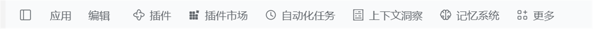
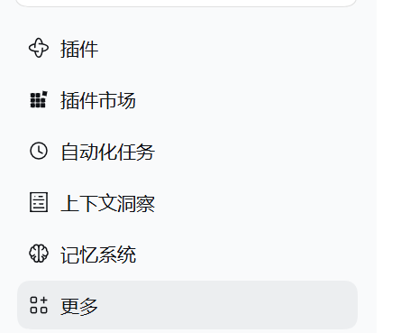

# dsh-panel-titlebar

[](https://github.com/githublmk/dsh-panel-titlebar/actions/workflows/ci.yml)
[](LICENSE)
[](https://github.com/deepseek-ai/deepseek-harness)

[English](README.md) | 简体中文

把侧边栏的一排全局面板挪到 Windows 应用通常放导航的地方：**标题栏里，“应用 / 编辑”菜单之后**。



## 解决的问题

装了若干面板（插件、插件市场、自动化任务、上下文洞察、记忆系统、更多）的 DeepSeek Harness profile，会把每一条都渲染成侧边栏顶部的整行。在笔记本上这就是常驻的**约 240px 纵向空间**，直接从会话列表里扣掉：



## 改造后

图标、文字、选中态、点击行为全部保留，只是变成与标题栏菜单同规格的紧凑条目横排在标题栏里；侧边栏直接从品牌行、新会话按钮和工作区列表开始：


## 实现方式

- 导航仍然是侧边栏插件自己的 `sidebar.panellist` 注册，不复制、不包裹、不替换、不删除任何条目——所以「更多」入口、它的固定/取消固定菜单、当前面板高亮、官方条目埋点全部原样保留。
- 只有一份样式表把那个已有的 `nav` 从侧边栏的 flex 流里取出（`position: fixed`），改成横排在标题栏带内。行规格对齐标题栏菜单：高 28px、字号 14px、圆角 6px、次要文字色，hover 与选中态取自主题变量。
- 样式表全部限定在 `html[data-windows-titlebar]` 下——这个标记只有 Desktop 的 preload 会写，**纯 Web 版界面保持原来的竖排不动**。
- 左边距是**测量出来的**，不是写死的：插件读取 preload 注入的 `[data-windows-menu]` 右边缘写入 `--dsh-panel-titlebar-left` 并保持更新，因此侧栏收起（菜单起点 48px → 84px）、切换语言、缩放窗口都不会错位。
- 条目是**开关式**的：再次点击当前已选中的条目会回到会话（`layout.selectPanel(null)`，与面板自带的“返回会话”同一去处），而不是把已经打开的面板再选一遍。这次点击会在原生处理器之前被拦下；「更多」入口不是面板条目，仍然照常打开它的菜单。

## 环境要求

- **DeepSeek Harness Desktop**（Windows）——标题栏带只存在于桌面端；纯 Web 版没有这条带子，插件按设计不生效。
- Harness `>= 0.2.1-0`（带 `sidebar.panellist` 行与「更多」入口的侧边栏）。
- 面板条目本身来自 profile 里安装的其他插件，本插件不创建任何面板。

## 安装

通过 Plugin Manager 指向本仓库目录：

```text
plugin_manager install_bundle
  target: <本仓库的绝对路径>
```

管理器会写入 profile 依赖、选中该 bundle 并挂载对应行。无需重启应用即可生效；若面板行没有立刻出现，刷新一次页面即可。

手工等价做法——在 profile 里加入对本目录的依赖，并在 profile 补丁中插入一行：

```yaml
# cordis.patch.yml
- insert:
    - id: panel-titlebar
      name: dsh-panel-titlebar
```

## 卸载

在 Plugin Manager 中卸载 `dsh-panel-titlebar` bundle（或禁用 `panel-titlebar` 行）即可，侧边栏立刻恢复原本的竖排列表，不影响其他插件。

## 自定义

| 想要的效果 | 改法 |
| --- | --- |
| 离菜单更远一点 | 在 `:root` 上覆盖 `--dsh-panel-titlebar-left`（默认是测量出的菜单右边缘 + 10px） |
| 更紧凑的行 | 去掉行规则里的 `padding` / `font-size`，即回落到原生 36px 规格 |
| 面板与菜单之间加一点间隔 | 给第一行加 `margin-left`，例如 `nav:has(> [class*="panelRow"]) > *:first-child` |

这些全在 [`client.js`](client.js) 的 `CSS` 常量里，没有构建步骤。

## 兼容性与已知限制

- 规则依赖侧边栏的 CSS Modules 类名后缀（`panelRow`、`panelTitle`、`panelGlyph`）以及承载面板行的 `nav`。若未来某个 Harness 版本重写侧边栏，本插件可能需要同步更新；客户端模块因此声明在 `@deepseek-ai/dsh-client-ui-sidebar` 之后加载。
- 标题栏带高 40px 且不换行：窗口很窄时，末尾条目会省略并最终被裁掉，而不会挤走窗口控制按钮。
- 「更多」弹层沿用原生锚定（打开时按触发按钮的位置测量）。
- 已在 Windows 11 + DSH Desktop（harness `0.2.1-rc.5`，150% 缩放）验证：放置位置、在线安装、侧边栏空间回收。hover 与「更多」弹层复用原生组件、为手动验证；CI 只覆盖静态契约。

## 开发

```text
client.js            浏览器侧：作用域样式表 + 标题栏对齐
index.js             宿主侧：空实现（全部逻辑在浏览器）
cordis.patch.yml     profile 加载时插入的 bundle 行
locale/en.json       Plugin Manager 中的英文标题与描述
locale/zh.json       Plugin Manager 中的中文标题与描述
icon.svg             插件清单使用的图标
test/bundle.test.mjs 静态契约测试（清单、补丁、语言资源、样式作用域）
```

```bash
npm run check      # 对两个模块做 node --check
npm test           # node --test test/
npm run pack:check # 本仓库会发布的 npm 内容
```

无依赖、无构建工具：浏览器模块是纯 ESM，由 Harness 的客户端模块加载器直接消费。

## 许可证

[MIT](LICENSE) © 2026 githublmk
